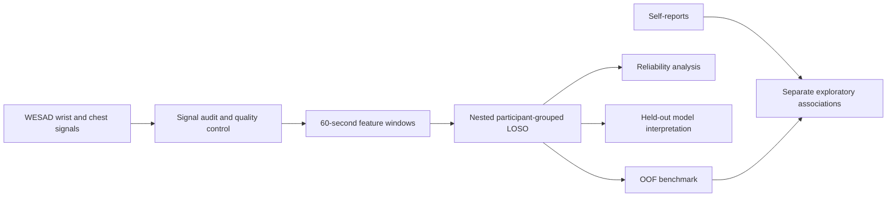

# Wearable stress and affect: from physiological signals to interpretable predictions

A subject-independent machine-learning pipeline comparing **wrist, chest and multimodal biosignals** from WESAD. The project combines physiological feature engineering, participant-level validation, uncertainty analysis and model interpretation.

## At a glance

- **Primary three-class task:** wrist Random Forest reached **68.29% balanced accuracy** for baseline, stress and amusement.
- **Secondary binary task:** wrist logistic regression reached **90.33% balanced accuracy** for stress versus non-stress.
- **Exploratory fusion:** late fusion reached **73.32%**; correlation-filtered early fusion reached **72.36%**.
- **Reliability:** rejection retained **75.42% of windows**, but acceptance varied substantially across participants and classes.

These are laboratory condition-classification results, not evidence of a validated everyday stress monitor. The original primary comparison is reported separately from secondary and post-hoc exploratory analyses.

## Approach

My background in **Cognitive Neuroscience** shaped the evaluation design: experimental condition, peripheral physiology and subjective experience are treated as related but distinct sources of evidence. The workflow separates condition classification, self-report analysis and model interpretation.

The recordings measure peripheral physiology, rather than neural activity directly.

## Pipeline



The dataset contains **15 participants**. Each participant is tested once under leave-one-subject-out validation; preprocessing and hyperparameter tuning use training participants only. Primary sensor comparisons use the same common valid windows.

The primary endpoint is **balanced accuracy averaged equally across participants**. Windows are 60 seconds long with 50% overlap and do not cross condition boundaries. See [methodology](docs/METHODOLOGY.md).

## Key results

Balanced accuracy and macro F1 below are equal-participant means. Tasks and analysis roles must be compared separately.

| Role | Task | Configuration | Balanced accuracy | Macro F1 |
|---|---|---|---:|---:|
| Primary | Baseline / stress / amusement | Wrist Random Forest | **68.29%** | 0.656 |
| Primary | Baseline / stress / amusement | Early-fusion logistic regression | 68.21% | 0.636 |
| Exploratory | Baseline / stress / amusement | Late-fusion logistic regression | **73.32%** | 0.700 |
| Post-hoc sensitivity | Baseline / stress / amusement | Early-fusion RF, correlation threshold 0.90 | 72.36% | **0.704** |
| Secondary | Stress vs. non-stress | Wrist logistic regression | **90.33%** | 0.889 |
| Secondary | Baseline vs. stress | Wrist logistic regression | **91.22%** | 0.904 |

The reduced early-fusion Random Forest retained approximately **35 of 45 features**. Its improvement over the full version remains a post-hoc sensitivity result, not a replacement for the primary analysis.

Late fusion exceeded this reduced model by **0.96 percentage points**, with a conditional paired bootstrap interval of **−6.72 to +7.46 points**. This comparison does not establish superiority. Bootstrap intervals condition on saved predictions and do not include retraining.

The benchmark also provides precision, recall, F1, class-specific results and matched participant-level comparisons. [Detailed results](docs/RESULTS.md)

## Reliability: what aggregate scores hide

Calibration uses **11 fitting, 3 calibration and 1 test participant** per fold. Participant-level acceptance ranged from **2.94% to 100%**. For S17, 100% accuracy after rejection represented only **two accepted stress windows**.

Among the 12 participants retaining all three classes, balanced accuracy increased from **63.2% to 64.7%**; this is a selected-subset result, not an improvement estimate for all 15 participants. Exploratory conformal coverage was **89.75% overall**, but only **63.13% for amusement**.

Calibration and coverage provide no guarantee for a new individual. [Reliability analysis](docs/RELIABILITY.md)

## What the models use

Saved models are explained on held-out participants using **Monte Carlo Shapley estimates**, training-only reference samples, beeswarm and waterfall plots, PDP and first-order ALE. The implementation does not require SHAP or Numba and is **not exact TreeSHAP**.

Pulse/PRV features were prominent in binary wrist classifiers; temperature, EDA and movement contributed to three-class wrist predictions. These describe **model reliance**, not causal mechanisms or validated biomarkers. Attribution uncertainty and correlated inputs require caution. [Interpretability](docs/INTERPRETABILITY.md)

## Self-reports

Questionnaires remain outside model training. Self-reported stress increased during TSST, but none of the six model–self-report associations remained significant after Holm correction. Classifying a condition therefore does not establish measurement of individual subjective intensity. [Self-report results](docs/RESULTS.md#self-reports-connecting-predictions-with-experience)

## Getting started

```bash
pip install -r requirements.txt
# Optional exploratory dependencies:
pip install -r requirements-exploratory.txt
```

Obtain WESAD separately from its original distribution, retain its subject folders and configure `configs/config.yaml` for your local dataset. Raw data are not redistributed here.

Run the core notebooks in order; see the [notebook guide](docs/NOTEBOOK_GUIDE.md) for exploratory extensions. The revised workflow uses `artifacts/revision_v2/` and verifies configuration and source-code fingerprints. Interpretability requires saved fitted models, matching fold metadata and OOF predictions; run `09b` when reduced models have not been persisted.

## Repository structure

```text
configs/       Dataset and analysis configuration
src/           Processing, evaluation and reporting modules
notebooks/     Core and exploratory analyses
docs/          Detailed methods, results and interpretation
artifacts/     Generated outputs; availability depends on execution
```

**Stack:** Python, NumPy, Pandas, SciPy, scikit-learn, XGBoost, LightGBM, Matplotlib, Seaborn, PyArrow and Jupyter.

## Limitations

- Fifteen participants, a laboratory protocol and no external validation.
- Condition labels, physiology and perceived stress measure different things.
- Participant variability, amusement errors and class-specific rejection remain material limitations.
- Shared LOSO training sets and overlapping windows limit independence.
- Exploratory model comparisons involve selection and multiplicity concerns.
- QC proxies and approximate attribution require cautious interpretation.

Research only; no clinically validated diagnosis or real-world stress-detection claim is made.

## References and acknowledgements

This is an independent WESAD analysis, not an official implementation or an exact reproduction of the original benchmark.

- **Schmidt, P., Reiss, A., Dürichen, R., Marberger, C., & Van Laerhoven, K. (2018).** Introducing WESAD, a Multimodal Dataset for Wearable Stress and Affect Detection. *ICMI*, 400–408. [Original paper](https://doi.org/10.1145/3242969.3242985).
- **Schmidt, P., & Reiss, A. (2018).** WESAD (Wearable Stress and Affect Detection). UCI Machine Learning Repository. [Dataset](https://doi.org/10.24432/C57K5T).

Dataset collection and experimental design belong to the original authors. Follow the original distribution terms and acknowledgement requirements.
